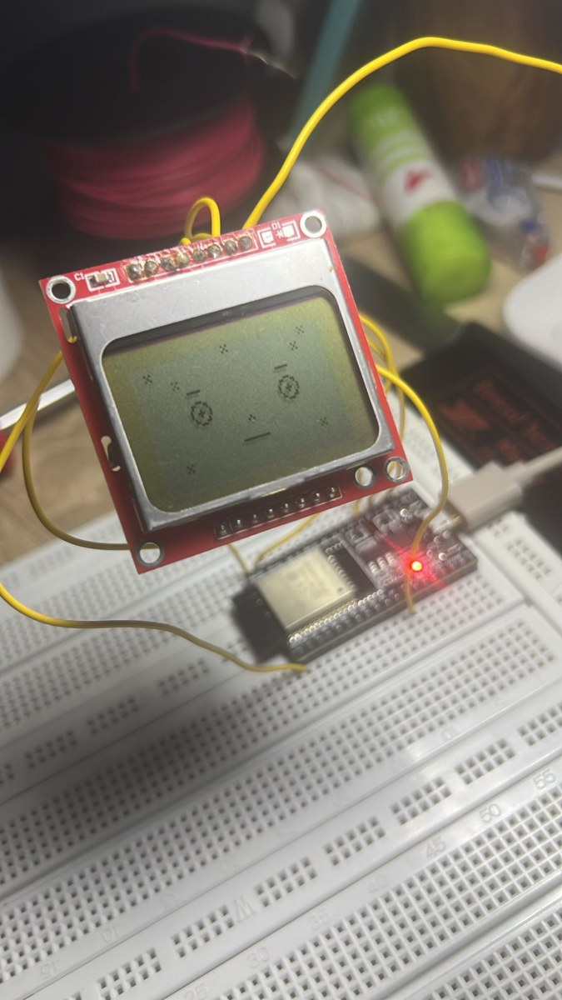

# ESP32 desk companion

A small desk companion: an **ESP32** drives a **Nokia 5110 LCD** that shows an animated face, and the face reacts to what I do while chatting with an AI assistant on my computer: *idle*, *listening* while I type, *thinking* after I press Enter, *talking* while the answer arrives, and *asleep* when I stop. Personal project, April 2026. **Status: retired (see below).**



> Unofficial hobby project. It does not use any AI service's API and is not affiliated with any AI company: it only looks at my own keyboard activity and my computer's network traffic.

## How it works
```
 Mac: pc/bridge.py ──USB serial, 115200 baud──▶ ESP32: esp32/companion/companion.ino ──SPI──▶ Nokia 5110
  (keyboard + network)      "THINK\n" ...             (draws the face for that state)
```

**PC side (Python, `pc/bridge.py`)** decides the state:
| What it sees | State sent |
|---|---|
| Any key pressed | `LISTEN` |
| Enter (without Shift) | `THINK` for 2.5 s |
| After that, incoming network traffic above a threshold (`NOISE_THRESHOLD` = 3000 bytes per 0.3 s) | `TALK` |
| Traffic quiet again for ~4.5 s after talking (`STABLE_COUNT` = 15 reads), or 20 s with no traffic at all | `IDLE` |
| No key for 2 s / 40 s | `IDLE` / `SLEEP` |
| Ctrl+C | `SHUTDOWN` (goodbye animation) |

Network traffic is read with `psutil` (bytes received since the last read), keys with `pynput`.

**ESP32 side (C++/Arduino, `esp32/companion/companion.ino`)** reads one command per line from the serial port and animates the face (eyes, eyebrows, blinking, floating "zzz" and "?", moving dots while thinking, an opening mouth while talking, twinkling stars) at about 5 frames per second.

## Wiring (ESP32 → Nokia 5110 / PCD8544)
| LCD pin | ESP32 GPIO |
|---|---|
| SCLK | 14 |
| DIN | 23 |
| DC | 2 |
| CS | 15 |
| RST | 4 |
| VCC / GND | 3.3 V / GND (the screen is **3.3 V**, not 5 V) |

## Run it
1. Arduino IDE: install the ESP32 board support and the libraries *Adafruit GFX Library* and *Adafruit PCD8544 Nokia 5110 LCD library*, then upload `esp32/companion/companion.ino`.
2. On the computer: `pip install -r pc/requirements.txt`, then `python pc/bridge.py /dev/cu.usbserial-0001` (replace with your port; list ports with `ls /dev/cu.*`, or set `COMPANION_PORT`).
3. macOS will ask for **Input Monitoring** permission for the terminal, which `pynput` needs to see key presses.

## R.I.P. (what went wrong)
This was a "let's see what happens" learning project: no plan, just testing new things and making mistakes on purpose or not. The biggest mistake came later: while testing a **new circuit idea** I connected the setup to **5 V** by mistake. The companion has been asleep ever since, so I consider it retired. The photo above is from when it still worked.

**What I learned (the hard way):**
- Check the supply voltage of *every* part before powering a new circuit: the ESP32 and the Nokia 5110 are 3.3 V devices.
- Measure with a multimeter before connecting, and change one thing at a time.
- Keep a spare board for experiments.

Run in peace, little companion.

## Limits (honest notes)
- It is a **heuristic**: it guesses the AI's state from Enter presses and traffic bursts. It cannot know what the assistant is really doing, and other network activity (downloads, video) can fool it. Enter in *any* application triggers `THINK`.
- The network threshold and timings were tuned by hand for my setup.
- **Privacy:** the keyboard listener runs system-wide but the program only checks whether a key was pressed, whether it was Enter and whether Shift was held. It never stores or sends what you type.

## Credits
- Screen driver: Adafruit GFX and Adafruit PCD8544 libraries.
